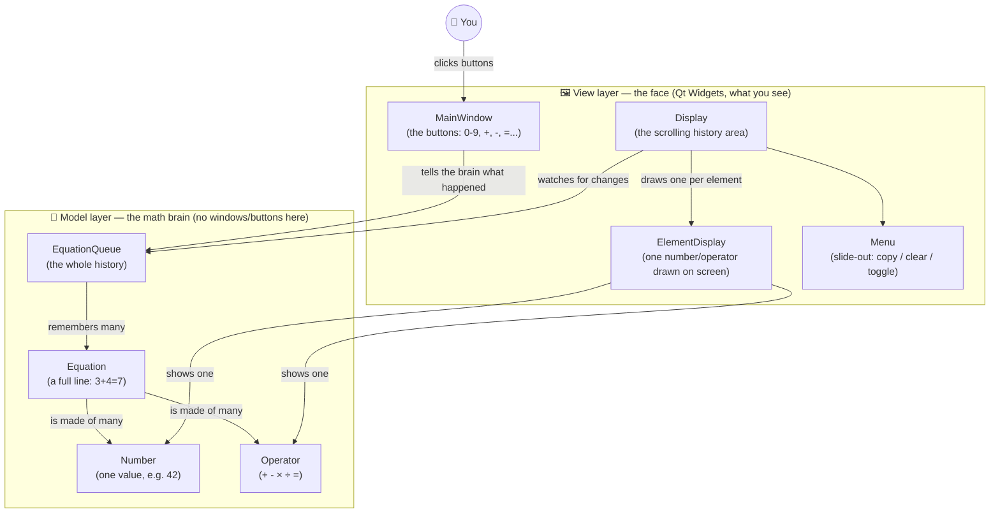
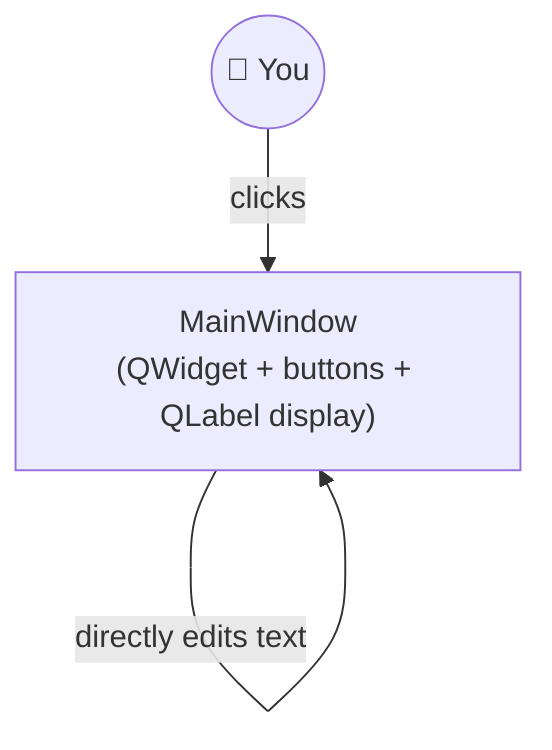
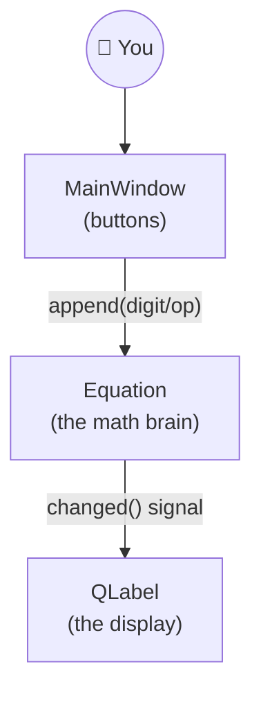

# Build-It-Yourself: CalculatorWithHistory Learning Plan

A step-by-step curriculum for building a Qt calculator app from an empty
folder, aimed at a **complete beginner**. Each phase adds exactly one big
new idea, produces something that actually runs, and ends with a small
celebration moment ("look what you just built!").

This plan lives next to the code so progress and explanations stay
together. Suggested pace: **one phase per sitting** (45–90 minutes each).
Commit to git at the end of every phase so she can literally see the
project grow, one commit at a time.

---

## 0. Tooling checklist (done once, together)

| Tool | Status on this machine | Notes |
|---|---|---|
| CMake | ✅ installed (4.4.2) | Build system: turns source files into a program |
| C++ compiler (MinGW-w64 g++ 16.2, UCRT) | ✅ found at `C:\mingw64-toolchain\mingw64\bin` | Turns C++ text into an `.exe` |
| Qt 6 (Widgets) | ✅ installed (6.9.3, MinGW 64-bit) at `C:\Qt\6.9.3\mingw_64` | Installed non-interactively with [aqtinstall](https://github.com/miurahr/aqtinstall) instead of the GUI installer: `pip install aqtinstall`, then `python -m aqt install-qt windows desktop 6.9.3 win64_mingw --outputdir C:\Qt`. Matches the MinGW-w64 UCRT compiler above. |
| Editor | Your choice | VS Code (with the C/C++ and CMake Tools extensions) or Qt Creator both work great. |

We already proved the CMake + compiler combo works: a "Hello World"
console app was configured, built, and run successfully in
[CalculatorTutorial](/d:/Learn-more/CPP/CalculatorTutorial).

---

## The big picture: what we're building

A calculator where every equation you type stays visible above the
current one, shrinking into "history," and numbers that repeat between
calculations get connected with a colored dashed line — like a memory
that shows its work.



**Key idea we're teaching along the way:** keep the *math* (Model) and
the *pictures on screen* (View) as separate as possible. This is called
the **Model-View pattern**, and it's one of the most important ideas in
all of software design — small apps and huge apps both use it.

---

## Phase overview

| # | Phase | Big new idea | Needs Qt? |
|---|---|---|---|
| 0 | Setup | Compiler, CMake, "hello world" | No |
| 1 | Console calculator | Variables, functions, if/else | No |
| 2 | First Qt window | GUI, events, signals & slots | **Yes** |
| 3 | The math brain (classes) | Classes, inheritance, `Equation` | No (console test) |
| 4 | Connect brain to face | Model-View pattern, custom signals | Yes |
| 5 | History list | Containers (`deque`), dynamic layouts | Yes |
| 6 | Make history look old | Fonts, colors, polish | Yes |
| 7 | The "wow" feature | Custom painting, matching numbers | Yes |
| 8 | Menu & extras | Animation, clipboard, tooltips | Yes |
| 9 | Ship it | Icons, shortcuts, packaging | Yes |

---

## Phase 0 — Setup & "Hello, Compiler!"

**Goal:** Make sure every tool works before writing anything interesting.

**New concepts (explain simply):**
- A **compiler** translates C++ text into a program the computer can run.
- **CMake** is a recipe that tells the compiler which files to combine and how.
- Nothing "graphical" yet — just proving the pipeline: *code → build → run*.

**What you build:** `src/main.cpp` that prints a friendly message, plus a
`CMakeLists.txt` recipe. ✅ Already created and verified in this folder —
run it together on her machine so she performs the "build" and "run"
steps herself.

**Steps to run Phase 0 (type these in a terminal, from this folder):**
1. **Configure** (reads `CMakeLists.txt` and generates build files, using
   the MinGW-w64 compiler as the toolchain):
   ```
   cmake -S . -B build -G "MinGW Makefiles"
   ```
2. **Build** (compiles `src/main.cpp` into `build/CalculatorTutorial.exe`):
   ```
   cmake --build build
   ```
3. **Run** (launches the program and prints the message to the terminal):
   ```
   .\build\CalculatorTutorial.exe
   ```

Step 1 only needs to be re-run if `CMakeLists.txt` changes or the `build`
folder is deleted; steps 2–3 are what you repeat every time you change
`main.cpp`.

**Milestone / Definition of Done:** She types the build command herself,
sees it compile, and sees her message printed in the terminal.

---

## Phase 1 — Console Calculator (pure C++, no Qt)

**Goal:** Learn the raw building blocks of programming using nothing but
text input/output — no GUI distractions yet.

**New concepts:**
- Variables and types (`double`, `char`)
- Reading input (`std::cin`) and printing output (`std::cout`)
- `if` / `else if` to choose between `+ - * /`
- Functions (put the math in its own function, call it from `main`)
- Basic error handling (what happens on divide-by-zero?)

**What you build:** A program that asks "Enter first number, operator,
second number" and prints the result. Something like:
```
Enter calculation (e.g. 3 + 4): 3 + 4
= 7
```

**Milestone:** She can calculate `+ - * /` on two numbers from the
terminal, and explain in her own words what a *function* is.

---

## Phase 2 — First Qt Window: Buttons You Can Click

**Goal:** Get *something visual* on screen as soon as possible — this is
usually the most exciting phase for a beginner.

**New concepts:**
- `QApplication`, `QWidget` — what makes a window a window
- The **event loop**: the program waits and reacts to clicks instead of
  running top-to-bottom like the console app did
- **Signals & slots**: Qt's way of saying "when X happens, do Y"
  (`connect(button, &QPushButton::clicked, ...)`)
- Layouts (`QGridLayout`) to arrange buttons neatly instead of guessing
  pixel positions

**What you build:** A window with a `QLabel` display and buttons
`0`–`9`, `+ - × ÷`, `=`, `C`. Clicking a digit **appends its text**
directly onto the label (no real math logic yet — that's next phase).
This intentionally separates "I can make Qt react to clicks" from
"I can compute the right answer."

**Architecture at this point:**

*(Notice: no separate "brain" yet — the window edits its own display
text directly. That's OK for now; Phase 3-4 will fix it.)*

**Milestone:** Clicking digits builds up a number string on screen,
`C` clears it. ✅ Done — `src/mainwindow.h` / `src/mainwindow.cpp` hold the
`MainWindow` class, `src/main.cpp` just starts the `QApplication`.

**Steps to run Phase 2 (type these in a terminal, from this folder):**
1. **Configure** — this time CMake also needs to find Qt, and needs to be
   pointed at the 64-bit compiler explicitly, because this machine also
   has an older 32-bit `C:\MinGW\bin` earlier on `PATH`:
   ```
   cmake -S . -B build -G "MinGW Makefiles" ^
     -DCMAKE_CXX_COMPILER="C:/mingw64-toolchain/mingw64/bin/g++.exe" ^
     -DCMAKE_PREFIX_PATH="C:/Qt/6.9.3/mingw_64"
   ```
   (`CMakeLists.txt` also falls back to that same `CMAKE_PREFIX_PATH`
   automatically if you forget the flag.)
2. **Build:**
   ```
   cmake --build build
   ```
3. **Run** — Qt's `.dll` files need to be on `PATH` for the `.exe` to
   find them (only needed because we didn't install Qt "for real" with
   the installer, which would offer to do this for you):
   ```
   $env:Path = "C:\Qt\6.9.3\mingw_64\bin;" + $env:Path
   .\build\CalculatorTutorial.exe
   ```

---

## Phase 3 — The Math Brain (Classes & the `Equation` model)

**Goal:** Introduce **object-oriented programming** by building the
classes that actually understand math, completely separate from any
window. Test them in a plain console program first (reuse Phase 1
skills) before touching Qt again.

**New concepts:**
- `class` — bundling data + behavior together
- Inheritance (`Number` and `Operator` both derive from `Element`)
- `std::vector` holding a sequence of "things that can be different
  types" via `std::shared_ptr<Element>` and `dynamic_cast`
- A tiny bit of **algorithm thinking**: operator precedence — why
  `3 + 4 × 2` is `11`, not `14` (do `×`/`÷` first, then `+`/`-`)

**What you build:**
- `Element` (base class), `Number`, `Operator`
- `Equation` — holds a sequence of elements, has `append(...)` and
  `calculate()`
- A tiny console `main()` that builds an `Equation` by hand and prints
  `calculate()`'s result, to prove the logic works **before** wiring up
  any buttons.

**Milestone:** `Equation` correctly computes `3 + 4 * 2 = 11` and
`10 / 2 - 1 = 4`, verified from a console test, no GUI involved.

---

## Phase 4 — Connect the Brain to the Face

**Goal:** Make Phase 2's window use Phase 3's `Equation` class instead of
raw text editing. This is the "aha" moment where Model-View clicks into
place.

**New concepts:**
- Custom Qt signals (`signals: void changed();`) — objects that aren't
  windows can still tell the UI "hey, something changed, please redraw"
- Why we separate "what is the answer" (model) from "how it looks"
  (view) — so later we can change the *look* without touching the *math*

**What you build:** `MainWindow` now owns an `Equation`. Button clicks
call `equation.append(...)`; the label listens for `changed()` and
redraws itself from `equation.text()`.

**Architecture at this point:**


**Milestone:** A fully working single-line calculator: `3 + 4 =` shows
`7`, `C` resets, and typing continues to work correctly after `=`.

---

## Phase 5 — Remembering the Past (History List)

**Goal:** Instead of one `Equation`, keep a whole *queue* of them — this
is the actual "History" in the app's name.

**New concepts:**
- `std::deque` — a container you can add/remove from both ends (used to
  cap history length, dropping the oldest entry)
- Dynamically creating widgets at runtime (`new QLabel` per history line)
  instead of designing them all up front
- `QScrollArea` — scrolling when there's more content than fits

**What you build:** `EquationQueue` (a deque of `Equation`s). `Display`
widget listens to it and creates/removes one line of labels per
equation, inside a scroll area.

**Milestone:** Every `=` press starts a *new* line, old lines stay
visible above, and you can scroll up through history.

---

## Phase 6 — Make History Look Like History

**Goal:** Pure polish phase — a good place to slow down and let her play
with visual tweaks without new hard concepts.

**New concepts:** `QFont`, `QPalette` (colors), adjusting size/position
based on state.

**What you build:** The current (last) line is big and dark; older lines
shrink and turn grey automatically when a new one is added.

**Milestone:** Visually matches "history fades, current stands out."

---

## Phase 7 — The "Wow" Feature: Connecting Matching Numbers

**Goal:** The signature feature of the app — if a number appears again
in the next calculation, draw a colored dashed line connecting them.

**New concepts:**
- Custom painting: overriding `paintEvent`, `QPainter`, `QPainterPath`
  (drawing curves, not just text)
- Comparing values across separate objects (`operator==` on `Number`)
  and mapping a value to a repeatable color (a **hash function**)

**What you build:** `ElementDisplay` (one label per number/operator that
can also draw a rounded outline) and a path-drawing step in `Display`
that connects matching numbers between consecutive lines.

**Milestone:** Type `3 + 4 =` then start a new line with `7` — a colored
dashed line should visually connect the `7` result to the new `7`.

---

## Phase 8 — Extra Powers: Menu, Copy, Clear, Tooltip Bubble

**Goal:** Round out the app with the finishing UI touches, reusing
everything learned so far (signals, painting, layouts) in a slightly
more advanced combination.

**New concepts:** `QPropertyAnimation` (sliding the menu in/out),
`QClipboard` (copy to clipboard), a custom `QDialog` with hand-painted
"speech bubble" shape for the "Copied!" tooltip.

**What you build:** A slide-out `Menu` with: copy history to clipboard,
toggle the connection lines on/off, clear all history.

**Milestone:** Clicking the hamburger icon slides a menu in; "Copy"
puts the whole history text on the clipboard and shows a "Copied!"
bubble that fades after ~1.5 seconds.

---

## Phase 9 — Ship It!

**Goal:** Make it feel like a "real" finished app.

**What you do:** Add a window/app icon, wire up `Enter`/`Backspace`
keyboard shortcuts, write a short README, and (optionally) use
`windeployqt` to package a distributable `.exe` folder she can send to
friends.

**Milestone:** A double-clickable, icon-having, shareable calculator
she built herself, phase by phase.

---

## Tips for teaching each session

- Start every session by **running** what exists so far — seeing it
  work builds momentum before adding anything new.
- Let her type the code herself where possible; you narrate/explain,
  she drives the keyboard.
- End every phase with a `git commit` — use the phase title as the
  commit message, so `git log` becomes a story of what she built.
- If a phase feels too big in one sitting, it's fine to split it
  (e.g., Phase 2 into "just a window" then "add buttons").
